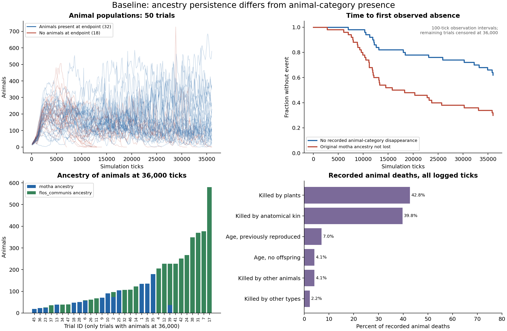
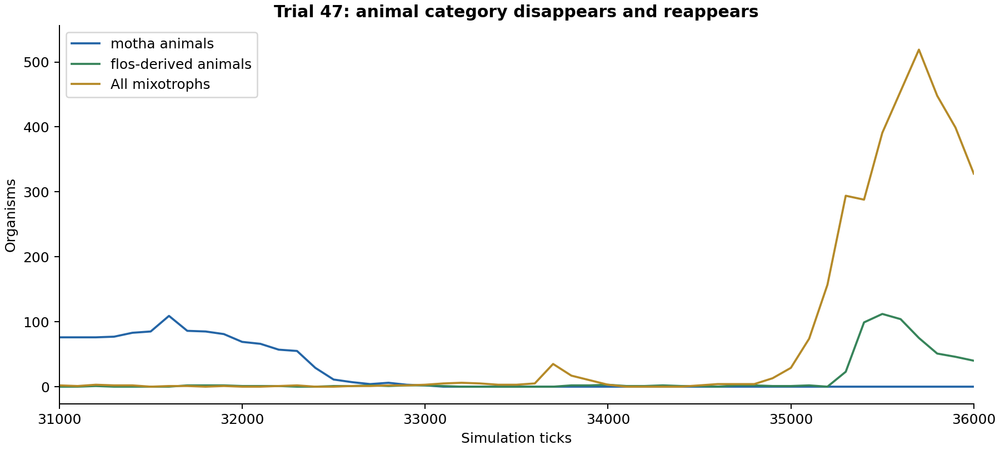
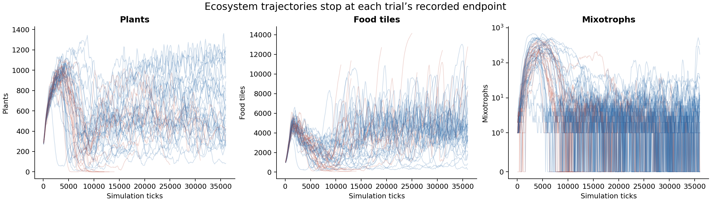

**Baseline analysis: 50 trials without the ecological extensions**

The main result is a distinction between persistence of the introduced animal ancestry and persistence of the animal ecological category. At the end of the recorded trials, the original ancestry labelled `motha` remains in 15/50 trials (30%), whereas 32/50 trials reach 36,000 ticks with animals present (64%). In 17 of those 32 trials, all final animals descend from the plant ancestry `flos_communis`; the original animal ancestry has disappeared. Consequently, total animal abundance substantially overstates persistence of the introduced animal ancestry.

These data provide a baseline of ecological turnover and evolutionary replacement. They do not by themselves establish equilibrium, diagnose maladaptation, or measure an effect of soil fertility, because there is only one experimental condition.

**Data and provenance.** The analysis uses all 50 `sep_off_XX_log.csv` files, the supplied `batch_summary.csv`, and the saved PNG snapshots in [`../raw/`](../raw/). There are 15,220 CSV rows: 15,170 distinct trial–tick observations and 50 duplicated endpoint timestamps caused by forced final samples. Each log contains logger run 1, starts at tick 100, and samples every 100 ticks. All trials end by tick 36,000. Duplicate rows have matching ecological states; the analysis counts their state once, retains extinction events from all rows, and sums interval birth/death counters across the raw rows. The forced endpoint samples have reset counters, so they do not double the recorded deaths.

`trophic_sep` is zero throughout, and all three soil fields are blank throughout. This is consistent with both extensions being disabled. The folder does not include the starting world JSON, controls JSON, random seeds or a simulator version manifest, so other controls, the grid dimensions, the 800-tick plant warm-up and exact initialization cannot be independently verified. The 1,000×1,000 PNGs alone do not establish the grid dimensions. All nine available tick-zero images are byte-identical, consistent with repeated trials of a common visual starting state. This does not establish independent random streams or byte-identical hidden states across all 50 runs.

The logs call the introduced animal ancestry `motha`, not `mobis_tetra`. At the first observation, animals have a median body size of eight cells, all have armour and killer cells, and the mean number of mouths is two. The separately supplied `mobis_tetra.json` template (not archived as a verified baseline input) has five cells, two mouths, two movers, one eye and no armour or killer. These results should therefore be attributed to the recorded `motha` baseline unless the starting-world provenance establishes the relationship to `mobis_tetra`. There are also five additional ancestry labels beyond `motha` and the two named plants. They indicate that the initial logged ecosystem is more complex than three pristine organism templates.

**Observed persistence and absence.** The word “animal” follows the logger's functional definition: an organism with a mouth and no producer. A plant-derived descendant can become an animal, and an animal-derived descendant can become a producer. Ancestry and current phenotype are therefore separate outcomes.

| Outcome | Trials | Percentage |
|---|---:|---:|
| Reached 36,000 ticks with animals present | 32 | 64% |
| Stopped with no animals present | 18 | 36% |
| Animal category absent at least once in recorded samples | 19 | 38% |
| No recorded animal-category absence through 36,000 ticks | 31 | 62% |
| Original `motha` ancestry present at 36,000 ticks | 15 | 30% |
| Original `motha` ancestry lost during observation | 35 | 70% |

Assuming independent trials, 95% Wilson intervals are 50.1–75.9% for the fraction reaching the horizon with animals, and 19.1–43.8% for original-ancestry persistence. These intervals describe sampling uncertainty conditional on this starting scenario and protocol; they do not include uncertainty about initialization, model assumptions or random-stream independence. The 18 trials stopped before or at the limit cannot be assumed to remain animal-free until tick 36,000: continued evolution was not observed after stopping.

The first observed loss of the original `motha` ancestry ranges from tick 2,800 to tick 36,000. The empirical survival curve first reaches 50% at approximately tick 15,800. Restricted mean time to first ancestry loss, capped at 36,000 ticks, is approximately 21,340 ticks. This is the mean of event time or the common horizon, not an estimate of uncapped lifetime. First disappearance is only localized to the preceding 100-tick interval; these time summaries use the upper, first-zero observation. For the animal category, 19 trials first reach zero between ticks 7,000 and 36,000; the median time to first absence across all trials is not reached. The median among just the 19 first-absence events is 18,000 ticks, which must not be interpreted as the overall median survival time.

**Evolutionary replacement is common.** Among the 32 trials with animals at tick 36,000:

| Ancestry of final animals | Trials |
|---|---:|
| `motha` only | 11 |
| Both `motha` and `flos_communis` | 4 |
| `flos_communis` only | 17 |

Across those endpoints there are 4,742 animals, of which 1,089 (23.0%) are `motha`-derived and 3,653 (77.0%) are `flos_communis`-derived. This pooled count is weighted toward populous trials; the trial counts above are the appropriate replication-level summary. The `flos_communis` ancestry has living descendants of any type at 41 recorded endpoints, and `imbricatis_vinea` at seven. Endpoints occur at different times in stopped trials, so these plant ancestry counts are not survival estimates at a common horizon.

Animal-category disappearance is followed by observed reappearance in trials 8, 29, 40 and 47. This is possible with trophic separation disabled. In trial 47, `motha` descendants disappear by tick 33,100, the entire animal category is absent at tick 33,200, and `flos_communis`-derived animals later return. At tick 36,000 the trial contains 40 animals and 328 mixotrophs, all despite its summary flag saying `extinct=true`. This is category re-emergence from other surviving organisms, not resurrection of a lost ancestry.

**Population dynamics.** Every trial has a substantial sampled animal expansion. The first observation at tick 100 contains 10–21 animals (median 17); subtracting births and adding recorded deaths over that interval gives 11 initial animals in every trial, subject to the logger's category bookkeeping. The summary's `founders` field is the first positive sampled population, not necessarily the number initially introduced.

Across all 50 logs, the median sampled peak is 322 animals (interquartile range 277.5–427.5; range 191–727). The median tick of the sampled maximum is 7,650, with peaks ranging from tick 2,100 to 35,200. Because logging is every 100 ticks, these are sampled maxima rather than guaranteed exact maxima. The trajectories show broad between-trial variation, expansion, fluctuation and occasional collapse. They do not support a single stable carrying capacity or a demonstrated periodic cycle.

The following endpoint statistics use only the 32 trials observed with animals at 36,000 ticks. They are conditional on reaching that endpoint and should not be generalized to all 50 runs.

| Endpoint metric | Median | Interquartile range | Range |
|---|---:|---:|---:|
| Animals | 106 | 50.25–227 | 19–580 |
| Plants | 589.5 | 382–816.5 | 84–1,229 |
| Food tiles | 4,103.5 | 3,173–4,967.5 | 304–10,774 |
| Mixotrophs | 4 | 1–9 | 0–328 |
| Animal species | 12 | 6.5–17.25 | 1–41 |

Twenty-five of these trials have one animal founder lineage remaining; seven have two. This indicates ancestry bottlenecks alongside continued anatomical species diversity. “Founder lineage” here is the logger's lineage identifier, distinct from broad original-species ancestry.

**Recorded deaths point to strong antagonistic interactions.** Summing interval counters across all logged ticks gives 1,652,064 animal deaths:

| Logged cause | Count | Share |
|---|---:|---:|
| Killed by plants | 706,807 | 42.8% |
| Killed by anatomical kin | 657,312 | 39.8% |
| Old age after producing offspring | 115,976 | 7.0% |
| Killed by other animals | 67,265 | 4.1% |
| Old age without producing offspring | 68,052 | 4.1% |
| Killed by other organism types | 36,652 | 2.2% |

These are death-weighted totals over trials of differing duration and abundance, not equal-weight trial-level risks or mortality rates. “Kin” means same species or anatomical similarity within the configured distance; it is not an independently measured genealogical relationship. The old-age-without-offspring counter is a possible reproductive food-limitation indicator, not a direct measurement of starvation. Organisms do not have a starvation death process in the inspected code.

At tick 100, the median fraction of plants with killer cells is 1.8%. Among the 32 animal-positive endpoints at 36,000 ticks, the median is 83.4%. This is consistent with a major change toward dangerous plants, alongside their large contribution to animal deaths. It is descriptive evidence, not a causal estimate of the effect of plant weapons.

Six trials (20, 21, 22, 48, 49 and 50) end with no living organisms of any logged type and 93–729 food tiles remaining. The other 12 animal-free endpoints retain plants and more than 4,000 food tiles. Their stock of food does not establish access by the final animals or conditions earlier in the collapse, and food can accumulate after consumers disappear. The baseline therefore contains both complete community loss and animal loss with remaining producers; a single universal explanation of global food exhaustion is unsupported.

**Trait changes combine evolution and ancestry replacement.** Among the 32 animal-positive endpoints, median mean animal body size is 4.048 cells, compared with eight cells at the first observation; median mouths per animal decline from two to 1.022. Median armour-bearing fraction is 2.7%, compared with 100% initially, while median killer-bearing fraction remains 96.0% and median eye-bearing fraction is 98.1%. These shifts are substantial, but the endpoint populations often come from plant ancestors. They cannot all be described as within-`motha` adaptation or loss of armour causing extinction. Ancestry-specific traits and controlled comparisons would be needed for those claims. No significance tests against another condition are appropriate with this folder alone.

**The supplied summary requires correction before reuse.** The audit identifies these issues without altering the source data:

| Trial | Supplied summary issue | What the full log shows |
|---|---|---|
| 8 | Peak 1 | Whole-trial sampled peak 506; a later tiny episode replaced the main episode in the summary |
| 29 | Peak 1 | Whole-trial sampled peak 265 |
| 40 | Peak 1 | Whole-trial sampled peak 234 |
| 47 | Peak 2 and `extinct=true` | Whole-trial sampled peak 330; 40 animals at tick 36,000 |

The inspected `batch.js` selects the latest extinction report, then merges that report over trial-level fields. This explains why a historical report can overwrite the current endpoint status and why episode peaks can replace whole-trial peaks. The first-episode classifications in the logs are: eight `misadaptation_candidate(self_predation)`, two `misadaptation_candidate(unclear)`, eight `exhaustion_no_trait_change`, and one `drift_without_selection`; 31 trials have no observed category extinction. There are 24 extinction episodes in total across the 19 affected trials. The summary's four `too_small_to_classify` entries describe later small episodes, rather than failure of those trials to grow a substantial animal population. These classifier outputs are threshold-based hypotheses, not demonstrated causal mechanisms. In particular, their post-peak death window can span thousands of ticks and differ markedly from deaths immediately preceding disappearance.

There are also 94 distinct observations where the exported ancestry-specific animal counts fail to sum to total animals: 86 in trial 10 and eight in trial 50. All 50 final endpoints reconcile. This limits interpretation of detailed intermediate ancestry composition in those two trials, while preserving the checked endpoint decomposition. The report does not silently assign the unmatched animals to an ancestry.

**Implications for the soil comparison.** The strongest primary endpoint is survival of the introduced ancestry, measured by living descendants of any phenotype; a second endpoint can require those descendants to remain animals. Total animal presence, abundance, mixotroph abundance and producer abundance should be reported separately. Otherwise, a treatment can appear to preserve the introduced animal when it actually facilitates replacement by plant-derived animals. Keep trophic separation fixed across the soil ablation, retain a separate trial-level outcome and episode-level classifier output, and record starting-world/configuration hashes, seeds, initial nutrient state and the time origin relative to animal introduction. Category-zero stopping is not an absorbing event when plants can evolve animals; choose an endpoint rule consistent with the biological question. Match the baseline founder/checkpoint to the intended `mobis_tetra` treatment before attributing differences to soil.

The evidence supports this baseline statement: **the unextended ecosystem frequently maintains an animal functional group, but the introduced animal ancestry is much less persistent; replacement, plant weapon evolution and antagonistic deaths are prominent features even before soil dynamics are introduced.**

**Reproduction and outputs.** From the repository root, run `python3 tools/analyze_baseline.py baseline/raw baseline/analysis` with the dependencies in [`tools/requirements-baseline.txt`](../../tools/requirements-baseline.txt) installed. The analysis was regenerated and checked with Python 3.14.8, NumPy 2.4.6 and Matplotlib 3.10.8. The script regenerates the tables and figures; this narrative is maintained manually. See the [archive README](../README.md) for setup and provenance. The analysis exports [trial-level metrics](trial_metrics.csv), [all extinction episodes](extinction_episodes.csv), [summary discrepancies](summary_discrepancies.csv), [aggregate metrics](metrics.json), and [SHA-256 hashes of every input file](input_manifest.csv). Figures are available as PNG, SVG and PDF, including [the overview PDF](baseline_overview.pdf). No simulator settings or raw results were changed.

Methods references: [NIST on Wilson proportion intervals](https://www.itl.nist.gov/div898/handbook/prc/section2/prc241.htm) and [NIST on right censoring](https://www.itl.nist.gov/div898/handbook/apr/section1/apr131.htm). The plots use empirical first-observed-absence times at the 100-tick sampling resolution, not an exact-time or interval-censoring model. Survivors at the observation limit do not have a known eventual extinction time.
